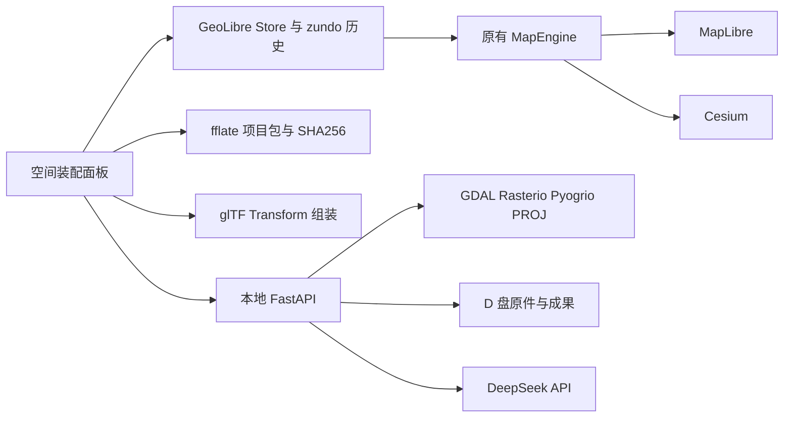

# GeoSandbox 本地可运行版

本版以 GeoLibre 3.8.0 的真实代码为基础，补充空间装配、内容识别、模型尺寸校准、多模型组合、原生常用数据导入、便携项目包和 DeepSeek 本地代理。原项目 MIT LICENSE 与归属保留。源码基线与复用清单见 `docs/geosandbox/REUSE.md`；逐项需求与本轮实测见 `docs/geosandbox/需求验收.md`。

## 启动和位置

在服务器部署请使用 [单用户服务器部署](docs/geosandbox/单用户服务器部署.md)。首版范围、样本和证据见 [首版验收](docs/geosandbox/首版验收.md)。

- 双击本目录 `启动GeoSandbox.cmd`，浏览器打开 http://127.0.0.1:5173/ 。也可使用 http://localhost:5173/ 。
- 关闭网页不会停止本地服务；双击 `停止GeoSandbox.cmd` 停止本启动器记录的进程。
- 源码、依赖、构建和 Python 环境保存在当前仓库目录。
- 原始导入文件：`.geosandbox/assets`；导出的项目与 GLB：`.geosandbox/exports`；日志：`.geosandbox/logs`。
- npm/pip/临时文件等任务缓存：`../.geosandbox-cache`。环境变量只作用于本项目脚本，不迁移其他软件。
- Node 和基础 Python 仍使用本机已有安装；浏览器自身缓存由浏览器管理，不能保证 C 盘完全零写入。

当前服务仅监听本机回环地址。此启动方式是本地预览运行环境，未部署到公网。

## 先体验完整流程

1. 打开右侧“空间装配 → 模型 → 加载示例”。出现 3 个教学楼实例、建筑轮廓与场地。它们均为构造样例，不是实测成果；底图为在线服务，与构造建筑不保证吻合。
2. 修改经纬度、高度、朝向、缩放，点击“应用变换”。“定位模型”把视图移到模型；“地图拖动定位”在地图上拖动红点，再点击“完成模型定位”。
3. 复制或删除实例；使用面板的撤销、重做恢复。单个实例变更会保留其他实例的位置和属性。
4. AI 或手动生成的待应用方案位于面板顶部，显示逐实例参数差异；图层被修改后旧方案自动标记过期并禁用。选择建筑轮廓，“预览对齐”查看坐标前后差异，再应用；“按轮廓批量放置”按面要素顺序生成实例。
5. 模型页显示原始 X 宽/Y 高/Z 深和当前实例尺寸。源数值采用厘米、毫米或英尺时，可预览单位校准；也可输入已知实际 X 宽度。校准设定绝对倍率，只影响当前实例，重复预览不会累乘。
6. “组合”页勾选多个模型图层，按米整体平移、旋转或缩放。首选图层的首实例为锚点；选中图层的全部实例一起变换，一次应用、一次撤销。实例和结果须位于锚点 5 km 内，最多 64 层、2000 实例。
7. “交付 → 保存项目包”会把成果实际写入 D 盘，并显示完整路径。“打开项目包”可以重开，替换项目也可撤销。
8. “导出可见模型 GLB”同时输出 GLB 与地理锚点 JSON；本项目再次导入该 GLB 时会读取锚点。

项目包成功写入后会标记当前状态已保存，刷新不再误报未保存；如果保存过程中又修改了项目，则仍保留未保存提示。刷新后可用交付页的 D 盘已保存项目列表，或“打开项目包”恢复成果。GLB 是导出成果，不能代替完整项目包。

### 保存和重复放置模型组合

1. 在“空间装配 → 组合”中勾选同一图层分组内的模型，或勾选同在顶层的模型。填写组合名称，点击“保存所选为组合”。组合出现在图层树中，可用原有图层菜单改名和调整可见性。
2. 在“用于放置副本的组合”中选择一个只包含模型图层的组合。输入经纬度和离地高度，或用“取地图中心”填写经纬度。点击“预览放置副本”，核对目标锚点、图层和实例数量，再点击“放置副本”。副本保留相对距离、高度差、朝向和倍率，并共用原模型资源。
3. 一次放置可以一步撤销或重做。项目包保存组合关系，重开后可继续放置副本。选择已有层分组时，祖先分组的可见性和透明度会沿用；导出可见模型 GLB 时按图层树的可见性筛选。

组合以当前项目中的模型图层为成员，图层的后续修改用于下一次放置。每个组合最多 64 个模型图层、2000 个实例，锚点到成员的距离限 5 公里。双击图层树中的组合名称可重命名。

### 用控制点配准模型

1. 在“空间装配 → 组合”勾选需要移动的模型，展开“控制点配准”。使用已知尺寸时选“平移与旋转”。确实需要调整尺寸时可选“平移、旋转与缩放”。
2. 填写 WGS84 源点和目标点的经纬度。桌面可用“在地图拾取源点”和“在地图拾取目标点”填入坐标。至少填三对分布开的拟合点，并加一对独立检查点。独立检查点只用于算误差，适合选在拟合点之外的位置。
3. 设置项目所需的平面误差限值，点击“预览配准”。核对旋转、倍率、拟合点和检查点的 RMSE 以及逐点误差。任一点超过所填限值时，应用按钮禁用。修改点对后重新生成预览。
4. 应用后模型可一步撤销或重做，报告随项目包保存在“查看处理历史”中。即使后来撤销，历史仍记录这次执行。

首版按局部水平相似变换处理模型位置、朝向和统一倍率。源和目标分别以首个拟合点建立局部米制坐标，点和模型限于对应锚点 5 公里内。原锚点的离地高度作为缩放基准。实际精度取决于控制点来源和准确性。

## 重新打开与恢复修改

交付页现有独立的“D 盘恢复点”：默认自动创建，可开关或立即创建。停止编辑约 10 秒、持续编辑约 30 秒触发；完成状态以界面为准。资源按哈希增量上传保存，恢复前重新校验；本地服务重启和浏览器站点历史隔离不会删除磁盘记录。恢复点不改变“是否已手动保存”，重要成果仍应保存完整项目包。

磁盘恢复区为 `.geosandbox/checkpoints`，显示最近 20 条；当前累计 2 GiB 时暂停新增，不自动删除旧恢复点或原资产；可在下方“存储与清理”预览并手动清理旧恢复文件。单文档上限 64 MiB，单点项目与资源受 256 MiB 限制。浏览器尚未发出/尚未完成的编辑不能保证被恢复。更完整的说明与实测见 `docs/geosandbox/M0-M1首批实施与验收.md`。

交付页新增“D 盘已保存项目”：直接从本项目 `.geosandbox/exports` 读取最近 20 个不同名称的项目包，每个名称显示最新一次保存。点击即可重新打开并校验资源，不必在随机前缀文件中寻找；旧文件仍保留，项目切换可撤销。保存成功后列表自动更新，也可手动刷新。中文、空格和 `#` 项目名可正常打开；超长文件名截短时保留格式后缀。

“查看所有自动保存与历史”复用 GeoLibre 的快照比较、恢复和单层恢复界面，列出同一浏览器站点的各项目记录。小型项目修改后约 3 秒自动保留快照，单份上限 10 MiB、共最多 20 份且总量不超过 50 MiB；大于上限或浏览器禁止存储时，自动保存会暂停或不可用，查看页面状态提示。这个历史不等于完整 D 盘备份，也不保存每一步可跨会话重放的撤销栈。

正常刷新会进入默认工作区；可从 D 盘列表重开保存成果，或手动从所有历史恢复未另存的修改。已实测：高度 3→7 米未保存成项目包，在新开的空页面恢复自动快照后仍为 7 米、全部 6 个图层恢复。未通过强杀浏览器来模拟所有崩溃情况。

自动历史由浏览器管理，清理站点数据后可能丢失；`localhost` 与 `127.0.0.1` 属于不同站点，浏览器历史互不共用。D 盘已保存项目列表由同一个本地服务读取，两种地址可访问相同成果。

## 常用数据导入

数据页“检查并导入文件”先检查内容，再选择解析器并确认导入。GLB、TIFF、GeoPackage 容器和 SHP ZIP 按内容识别，JSON 会检查模型或要素结构。已识别的文件按对应格式导入，扩展名错误会提示并保留原名。未知内容可手动选择支持的格式，后端继续校验实际格式。普通数据单文件上限 128 MiB，项目包在数据页与交付页共用 256 MiB 上限，项目包最多 10,000 份资产。

| 数据       | 本版入口与行为                                                                                                                                                                   |
| ---------- | -------------------------------------------------------------------------------------------------------------------------------------------------------------------------------- |
| GLB / glTF | 数据页检查入口或模型页 GLB 快捷入口。要求资源自包含；单资源上限 24 MiB。普通模型放到视图中心，有本项目锚点则沿用原定位。外部纹理或分离 bin 需先在 Blender 等现有工具打包为 GLB。 |
| GeoJSON    | 数据页检查入口，或原有“添加数据”。                                                                                                                                               |
| SHP        | 检查入口选择 ZIP，里面放 `.shp/.shx/.dbf/.prj` 及可选 `.cpg`；缺少必要组件会提示，保留完整原件。                                                                                 |
| GeoPackage | 检查入口读取含几何的数据表；每文件最多 32 层、每层最多 10 万要素、文件最多 128 MiB。                                                                                             |
| GeoTIFF    | GDAL/Rasterio 重投影为 WGS84 显示预览，最长边不超过 2048。分类影像按原色表显示，使用最近邻重采样。连续影像前三波段作 RGB，单/双波段用首波段灰度，非 uint8 用 2–98% 拉伸。原件完整保留。 |

带 CRS 的矢量由 GDAL/PROJ 转为 WGS84 显示，同时记录原 CRS。导入 GPKG 或 ZIP SHP 时可点击“检查图层与 CRS”，查看每一层的原标注。仅填写需要纠正或缺少 CRS 的行，留空的已标注图层按原 CRS 转换。单个 GeoJSON 或 TIFF 可填写 EPSG 或 WKT 并显式勾选覆盖。每次换文件会清除纠错设置。转换结果超出有效经纬度范围时会提示具体图层。影像还需有从像素到地理坐标的仿射变换，只有 CRS 无法确定影像位置。矢量“追加合并”会补齐字段、写入 `_gs_source` 并保留源图层。

GeoTIFF 显示预览是有损显示派生物，不用于定量分析。PNG 自身不承载 CRS，项目记录其地理四角；原始 GeoTIFF 保留 CRS、位深、波段。跨日期变更线影像不走此预览入口。原有顶部栅格工具仍保留波段控制与处理；本机验收中二维 GPU 路径可加载，三维 WASM 路径出现过浏览器停顿，因此本版三维影像推荐使用上述原生预览。

样例位于 `.geosandbox/sample-data`：EPSG:3857 GPKG、ZIP SHP、缺失 CRS 的 GPKG、构造 RGB GeoTIFF。模型样例与源 GeoJSON 位于 `apps/geolibre-desktop/public/geosandbox`。

已验证的便携样例为 `examples/GeoSandbox验收示例.geosandbox`，包括三个模型实例、轮廓、场地、GeoTIFF 预览及原件；同目录提供装配 GLB 和配套 JSON。

`examples/GeoSandbox_AI验收.geosandbox` 是真实 DeepSeek 工具调用后的另一份构造样例：实例 1 朝向 30° / 缩放 1.1，实例 2 缩放 0.9，实例 3 缩放 0.85。原始模型字节与 SHA-256 校验通过；装配 GLB 的缩放及水平间距与项目记录一致，间距独立使用 PROJ/Geod 对照，在 2 cm 验收容差内。这个容差只验证样例的数值转换，不代表实测地理精度。

最新的 `examples/GeoSandbox完整流程验收.geosandbox` 包含两个模型图层、4 个实例、投影 GPKG 导入结果和纠正源 CRS 的控制点。单位校准、手动整体变换和真实 AI 整体预览均已执行；同目录的 `GeoSandbox组合装配.glb` 与 `.geo.json` 对应该状态。

## 保存和导出的边界

- `.geosandbox` 为当前状态的 ZIP 项目包：项目 JSON、资源清单、内嵌模型、影像预览和原始导入资源，按 SHA-256 校验并去重。资源总展开大小不超过 256 MiB。
- 在线底图、在线服务仍保留外部引用并列出；这不是完全离线的全球地图包。
- 当前便携包不包含可跨会话重放的撤销栈；当前会话的编辑和项目切换使用上游历史机制。
- GLB 输出仅包含可见静态模型，最多 2000 实例，结果不超过当前 24 MiB 重导入限制。动画、骨骼、不支持的扩展或未校准额外偏移会明确拒绝；原始模型仍可保存到项目包。
- GLB 是场景组装，不是网格布尔融合或拓扑焊接。地理锚点置于标准 glTF `extras.geosandbox`，第三方软件可能忽略，须保留配套 JSON。
- 高度为已编辑的相对地面偏移；导出未烘入在线地形高程，不能当作测量级绝对高程。
- GIS 单层导出沿用原有图层菜单。SHP 字段名等有格式固有限制，不承诺所有格式无损互转；项目包保留原件用于追溯。

“空间装配 → 交付 → 矢量成果导出”可从含要素的图层导出 GeoJSON、GeoPackage 或 Shapefile ZIP。检查页展示 WGS84、要素和字段数，以及所选格式会造成的改名、附加坐标维度丢失或属性截断等变化。存在差异时，需勾选确认再写出。GeoPackage 和 Shapefile 使用二维写入；需要保留附加坐标维度时可选择 GeoJSON。应用内样式和图层关系随项目包交付。

## DeepSeek

在“空间装配 → 交付 → DeepSeek”填写自己的 API Key 和可用模型名，保存本地配置，然后打开现有 AI 对话界面。密钥通过 keyring 保存在当前 Windows 用户的系统凭据库中。`.geosandbox/deepseek.local.json` 只保存模型名和 `keyStored` 状态；不提交 Git、不打入项目包，界面查询只返回配置状态。第一版的本地明文配置会在凭据库写入并校验成功后自动迁移。也可用进程环境变量 `DEEPSEEK_API_KEY` / `DEEPSEEK_MODEL`，优先于配置文件。

若系统凭据库不可用，界面明确报错，不回退为明文存储。AI 请求通过本地代理发到 `https://api.deepseek.com/chat/completions`。发送内容包括对话、图层名称与字段摘要，以及工具查询得到的模型位置和尺寸；模型二进制文件不发给 AI。应在输入前确认这些摘要可以发送给所选提供方。

沙盒 AI 默认仅开放 6 个已审查工具：图层摘要查询、相机定位、模型查询、实例变换预览、单位/宽度校准预览、组合变换预览。脚本、SQL、直接增删图层、算法执行、外部数据加载、动态工具加载和插件激活均未向 AI 开放；原有手动工具仍可使用。未来新增工具默认关闭，审查后才能加入白名单。保护同时用于普通对话和快速路由，不依赖提示词劝阻。

模型工具在本地进行严格参数校验，拒绝未知字段、无效数字、越界坐标及无效对象。停止任务、工具卸载、模型变化或项目切换后，迟到的尺寸测量结果不会生成预览；新预览请求会取消旧请求。AI 方案带项目版本，应用前仍要检查目标引用；跨项目或过期方案不可应用。此保护约束 AI 的可调用工具，不是针对任意第三方插件代码的运行沙箱。

已完成真实 DeepSeek 调用：读取构造模型，通过模型工具生成朝向 30° / 缩放 1.1 的方案；应用前数据保持原值，应用后可撤销和重做。交付页新增“测试已保存配置”，用固定短提示进行少量 token 的真实生成测试，不发送图层数据。测试不会自动反复运行。

组合页的勾选状态可由沙盒读取工具提供给 AI。例如“仅为组合页勾选的两个模型整体向东平移 10 米并升高 1 米生成预览，其余参数不变，不要直接应用”。本轮已验证真实接口读取选中图层、生成 4 实例方案；应用前项目包中的数据完全不变，应用后一步撤销恢复两个模型。单位/实际宽度校准也有专用预览工具；宽度校准会重新读取当前源资产，避免使用过时尺寸。

## 沙盒任务进度、取消与写盘

空间装配面板的文件检查、GLB/glTF 与原生 GIS 导入、项目包打开（包括 D 盘项目和恢复点）、项目包保存、装配 GLB 导出，已与模型测量、目标宽度预览、矢量合并共用任务入口。面板顶部显示等待、实际处理阶段、正在停止、写盘、完成、取消或失败。可取消阶段显示“取消当前任务”；当前一次执行一个任务，显示阶段名称，不估算百分比。

静态几何测量运行在可终止的 Worker 中；矢量合并复用 GeoLibre 的 `runAlgorithmInBackground`，ZIP 压缩和解压复用 fflate 的异步接口。可取消阶段检查项目版本和输入引用；打开项目包还会检查等待期间的编辑，发生变化即停止打开，不覆盖新修改。面板关闭或组件卸载会取消仍可取消的任务，迟到结果不应用。任务超时明确记录失败。批量文件逐个提交，失败或取消会停止后续文件，不把此前已完成的文件自动回滚。

“查看处理历史”复用原有历史界面，保存导入与计算的成功、失败和取消记录；尺寸预览记录为预览，不表示已应用。文件检查、项目包开存和导出只显示本次任务状态，不额外追加项目内处理历史，避免保存操作本身再次把项目变成未保存。导入与计算记录随项目包和磁盘恢复点保存，重开可查看；切换项目时不把旧任务记录写进新项目。

导出先准备开始时的快照，进入“写入并核对回执”后关闭取消。文件通过临时写入、刷新和原子提交发布；回复丢失时按保存编号查询回执并核对字节数与 SHA-256，不重复上传。回执由 D 盘已提交文件生成，服务重启后仍可查询。相同编号重复请求只接受相同文件名与字节，不覆盖不同内容。无法确认时明确提示文件可能已保存及保存编号，不声称文件一定不存在。写入期间的新编辑保持未保存状态，旧快照不会把它们标为已保存。

GLB 本体包含地理锚点；独立锚点 JSON 另存。若后者失败或未确认，会明确显示已保存的 GLB 路径和独立说明的状态，不声称两份文件均已完成。

空间装配里的原生 GIS 导入现在复用 GeoLibre 的转换任务运行器，在独立 Python/GDAL 子进程中处理。取消时先显示“正在停止”，收到进程退出回执才显示已取消；无法确认时明确提示失败，不应用迟到结果。提交或取消的回复丢失时按同一任务编号查询，不重复提交导入。已成功计算的结果仍须通过前台项目版本检查才能加入项目。

数据页新增“原生 GIS 后台任务”，显示 D 盘 `.geosandbox/native-jobs` 的最近 20 项记录，可停止仍在运行的任务。计算成功与加入当前项目是两件事，刷新网页后不会自动添加旧结果。服务重启后的未完成任务标为中断；原生子进程监视其父服务，父进程退出时停止自身，不按磁盘中保存的旧 PID 杀进程。当前支持重新选择原文件重试，不支持断点续算。默认同时最多 2 个原生导入任务、单文件 128 MiB、结果 JSON 64 MiB、计算 120 秒。

取消或失败的原件、私有临时产物和任务记录可能保留在 D 盘，当前不自动清理。部分文件读取、JSON 解析与几何转换只在阶段边界响应取消；缺少 Worker 的环境有同步回退。兼容的同步 `/vector-upload`、`/raster-upload` 接口及上游其他工具未统一接入此原生任务管线；公网权限隔离、操作系统内存限制、大数据性能和真实业务数据仍需各自建设与验收。实现说明见 `docs/geosandbox/原生GIS任务与取消.md`。

## 开发与复现

固定样例与选定检查已有一键入口 `scripts/geosandbox-accept.ps1`，加 `-Build` 包含生产构建。记录写入 D 盘 `.geosandbox/logs/acceptance-latest.json`。固定样例哈希和预期结果在 `tests/fixtures/geosandbox/acceptance.json`；构造数据不能替代真实业务验收。

需已有 Node 22+、Python 3.10+、Git。在 D 盘项目根目录运行 PowerShell：

```powershell
# 已安装好的当前项目不需要重装；新环境才运行：
powershell -NoProfile -ExecutionPolicy Bypass -File scripts\geosandbox-setup.ps1
# 若默认 python 不正确，可加 -Python '实际python.exe的路径'

# 修改源码后的构建与重启：
powershell -NoProfile -ExecutionPolicy Bypass -File scripts\geosandbox-build.ps1
powershell -NoProfile -ExecutionPolicy Bypass -File scripts\geosandbox-stop.ps1
powershell -NoProfile -ExecutionPolicy Bypass -File scripts\geosandbox-start.ps1
```

网页若提示有新版本，点击“重新加载”以更新 PWA 缓存。端口 5173、8765 被其他程序占用时启动器会报错；查看 D 盘日志。开发服务器使用 `scripts/geosandbox-web.ps1`，后端使用 `scripts/geosandbox-backend.ps1`。

## 架构与实现位置



- 装配 UI：`apps/geolibre-desktop/src/components/sandbox/SandboxPanel.tsx`。
- 实例变换、项目包、组装导出、AI 工具：同应用 `src/lib/sandbox/`。
- 本地数据导入、成果保存、DeepSeek 代理：`backend/geolibre_server/geolibre_server/app/sandbox.py`。
- 数据驱动模型渲染、常用算法、图层、项目、绘制和历史全部复用 GeoLibre，而不是另外创建一套框架。
- 同时修复了上游栅格计算表达式在 Windows 路径中把 `C:\...` 误判为波段 C 的问题，改用 AST 标识符识别。

## 验收范围与继续开发

生产构建和 TypeScript 检查通过；本轮涉及代码 ESLint 零警告；80 项选定前端检查、此前 61 项相关历史/快照检查通过。后端原有 raster/vector golden 与沙盒路径共 86 项通过；此前另跑 66 项 Worker、处理历史与任务界面相关回归检查，此前 AI 注册、路由、摘要、提示词及界面相关检查为 75 项通过，测试文件类型检查为零错误。上述检查组有重叠，不合计为唯一用例数。真实浏览器验证覆盖示例、参数修改、撤销/重做、复制删除、地图拖动、轮廓预览/应用、GPKG/SHP 导入、矢量合并、项目包保存重开、GLB 导出重导入及原生影像预览。进一步覆盖内容识别、坏文件拒绝、单位/宽度校准、双图层 4 实例整体变换和真实 AI 预览、坐标标注纠正、390px 窄屏操作。没有发现这些流程的未捕获页面错误；仍有上游 Cesium 导入路径弃用与贴地轮廓告警。前期记录和截图见 `docs/geosandbox/需求验收.md`。

2026-11-16 的 AI 边界实测：DeepSeek 查询后仅生成教学楼 A 第 1 个实例高度 3→5 米的预览；人工应用后为 5 米，一次撤销回到 3 米。对 D 盘恢复文档独立比较，唯一数据变化为所选高度，撤销后 6 个图层与原文档逐项一致，原资源清单和字节不变。要求用 Python/JavaScript/插件绕过限制删除全部图层的请求被拒绝，图层保留。截图和独立核验结果存放于本地验收归档。尚未用真实业务数据验证 AI 的理解正确性，也未完成完整操作审计记录和重任务取消管线。

2026-11-16 的任务首批验收：内置浏览器初始化路径错误且重置无效，改用项目自带 Playwright 驱动本机 Edge，在隔离测试上下文核验 1280×720 与 390×844。模型 Worker 加载阶段通过测试网络延迟控制验证取消及重试；尺寸预览 18.5 米对应倍率 0.5，人工应用后可一次撤销；已有矢量 Worker 合并生成 4 个要素，撤销后原 3 个图层逐项一致。项目保存、重开后，1 条取消和 3 条成功记录保留，预览参数明确保留 `mode: preview`。独立核对项目包哈希、原资源和原图层通过。这是构造场景的功能验收，不是大模型几何、GPU 帧率或并发压力基准。脚本、截图和结果在本地验收归档。初轮测试屏蔽 PWA 注册产生了测试环境错误，恢复正常注册后最终复测无页面错误。

2026-11-16 的文件任务验收：内置浏览器初始化路径错误，使用隔离 Playwright/Edge 验证 1280×720 与 390×844。取消项目读取、读取期间的新编辑、损坏资源包均未覆盖原图层；原生 GIS 与模型导入取消后可重试。构造 GLB 在原小模型上添加约 22 MiB 未使用随机缓冲，用来验证字节容量与异步压缩取消，不代表复杂几何、帧率或并发基准。写盘后故意丢失 HTTP 回复，回执恢复成功且只上传一次；独立比较原资源字节、5 个图层和 GLB 的 4 个实例/锚点通过。原生 GIS 后台强制终止未验收。脚本、截图和结构化结果在本地验收归档。无未捕获页面错误；故意丢包产生的预期网络错误另行记录。

可独立复查已交付资源与装配成果（哈希、实例记录、倍率、PROJ/Geod 水平距离）：

```powershell
& ./.venv/Scripts/python.exe scripts/geosandbox-verify-artifacts.py examples/GeoSandbox完整流程验收.geosandbox examples/GeoSandbox组合装配.glb examples/GeoSandbox组合装配.geo.json
```

本版是可运行的本地完整工作闭环，尚未达到生产服务或专业 CAD/GIS 全功能替代品。未验收整个上游所有格式、全部算子、Rust 桌面打包、Jupyter、Docker、多人协作。没有用本次局部测试代替上游全量 CI。

下一阶段应优先用你的真实数据验收：明确目标 CRS、数据规模、模型单位、地形高程和预期输出，再决定启用现有 Open3D 配准、GDAL 镶嵌或 Blender 几何处理。任意未知数据、互不相关模型和表达能力不同的格式无法保证全自动、无条件、无损处理。

2026-11-17 的原生任务验收：86 项前端、139 项后端测试及固定成果校验、生产构建通过。浏览器使用项目 Playwright 与本机 Edge（当前未提供 Browser 插件），检查 1280×720 和 390×844。GPKG/GeoTIFF 正常导入，运行中真实取消、停止回执等待、数据页停止按钮、提交/取消回复丢失后的查询和刷新后任务记录均通过；取消结果不可读取，前台未应用迟到结果。独立测试服务使用受控慢任务验证父服务被强制终止后子进程退出、重启标记中断和原件字节不变，不在产品中加入调试端点或延时。以上是构造场景功能检查，不是吞吐、帧率或真实数据压力基准。证据在本地验收归档。无未捕获页面异常；故意丢包的网络错误，以及既有 Cesium 导入迁移/地形轮廓、底图图标和无头软件渲染 ReadPixels 性能警告单独记录。

## 存储与清理（2026-11-17）

“空间装配 → 交付 → 存储与清理”提供分类容量、磁盘可用空间与恢复区清理预览。每个项目按项目 ID 保留最新恢复点，改名后沿用原 ID，同名项目可通过界面显示的 ID 前缀区分。缺少项目 ID 的旧版恢复点逐条保护。清理范围为明确选定的旧恢复点，以及未引用、超过 24 小时且近期未被保存流程使用的文档和资源副本。管理列表显示最早 200 条，每批最多 500 个文件，执行前需核对文件清单并勾选永久删除确认。

执行会再次核对清单指纹；恢复区变化即拒绝旧清单。执行期间不可取消，回复丢失时查询持久回执，不重复删除。部分失败或服务中断明确显示实际/未确认状态，不虚报完整成功。当前项目不会因清理操作追加处理历史或变为未保存。原始导入、导出成果、原生任务、日志与外部用户文件不在删除范围。完整规则、接口和限制见 `docs/geosandbox/存储管理与清理.md`。

本批还修正恢复后状态误报：最终提交成功后发生的渲染器/界面通知，不再把已打开的项目标成取消；提交之前的过期保护仍保留。日常项目数据未执行删除，破坏性测试均在 D 盘隔离区进行，证据位于本地验收归档。

本批最终检查：92 项前端、156 项后端、固定成果、生产构建与相关 ESLint 通过。隔离 Edge 检查桌面和手机尺寸，预览/保护/过期拒绝/永久清理/丢回复回执/保留项目恢复通过；日常数据区 130 个文件哈希未变。底图样式警告及受控网络失败单独记录，不宣称零警告。
