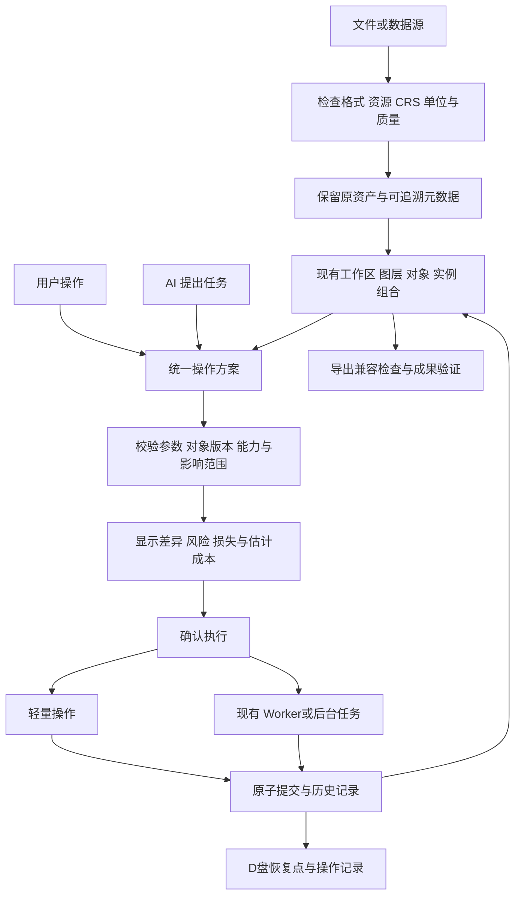

# GeoSandbox 建设框架与验收总纲

首批实施进度见 [M0-M1 首批实施与验收](M0-M1首批实施与验收.md)。总纲中列出的待建设事项不因此自动变为已完成。

2026-11-16 后续进度：已接入默认 AI 工具白名单、严格模型参数校验、异步预览取消与过期保护，以及对话发送范围提示。普通对话与快速路由均受约束，未审查的写工具、脚本、工具加载和插件激活不向 AI 开放；细节与验证见根目录使用说明。完整操作审计、沙盒重任务取消管线、恢复区清理和真实数据基准仍待完成，M1 尚未整体结束。

任务首批进度：模型测量/尺寸校准预览使用可终止的测量 Worker，矢量合并接入既有 Worker 执行器；显示实际阶段并复用处理历史记录成功、失败和取消，提交前检查项目版本与输入引用，保存重开后记录保留。全量导入导出与后端计算的任务化、重启后任务恢复仍未完成，不能据此把整个任务模块标为完成。

文件任务进度：空间装配的文件检查、模型/GIS 导入、项目包打开及保存、GLB 导出已接入阶段状态；打包解包复用 fflate 异步能力。打开项目包时保护并发编辑；写盘阶段关闭取消，按保存编号和资源哈希核对回执，丢失回复不重复上传。文件开存与导出不追加项目内处理历史，避免保存后再次变脏。该批验收时原生 GIS 取消仅阻止结果应用；后续进度见下段。

原生任务后续进度（2026-11-17）：空间装配里的 GDAL 导入复用既有 conversion 子进程运行器，支持真实进程取消、退出确认、超时、D 盘任务记录和结果哈希；数据页可查看与停止任务。服务重启时未完成任务标为中断，父服务退出后原生子进程停止；提交或取消回复丢失时查询同一编号，不重提。86 项前端、139 项后端、生产构建及隔离 Edge 页面验收通过，独立服务强制退出与重启实验通过。全工具统一任务化、自动续算、存储清理、完整操作审计和真实数据性能仍未完成，M1 不能整体标为结束。细节见 [原生 GIS 任务与取消](原生GIS任务与取消.md)。

存储后续进度（2026-11-17）：交付页已提供分类容量与恢复区手动清理。保留同名最新恢复点和共享/近期使用资源；先预览文件清单，再按指纹执行，回执持久化，异常图与链接路径阻止清理。原始文件、导出、任务与日志只统计、不自动删除；全站总配额和自动归档仍待建设。恢复后状态误报已修正，保留项目通过恢复入口核验。详见 [存储管理与清理](存储管理与清理.md)。

编制日期：2026-11-16。代码核对基线：`d03f3a8`。本文是后续建设方案，不代表其中待建设能力已经实现；本次核对了代码与既有验收记录，没有重新执行上一轮全部测试。

## 1. 当前判断与产品目标

目前已经形成小型场景的“导入—检查—定位/校准—实例编辑—组合—AI 预览—撤销—保存/恢复—导出”闭环。已验收数据主要是构造样例，尚不能据此称为面向真实复杂数据的成熟通用沙盒。不要用未经定义的完成百分比表示进度。

首个稳定版定位：**面向个人、本地优先、以常用二维/三维空间数据进行对象级编辑和装配的沙盒，保留常用 GIS 处理能力，并让 AI 提出可验证、可回退的操作方案。**

交付需要同时满足：数据可信、空间位置可信、操作可控、结果可检查、失败可恢复。首版以对象/要素/实例为编辑单位；网格布尔、拓扑重建、自动语义切分和多人协作是后续扩展，不作为第一版完成的前提。

当前范围：GeoJSON、ZIP SHP、GPKG、GeoTIFF、自包含 GLB/glTF。已有输入、显示、编辑、处理、导出能力必须分开记录，不能用“支持某格式”概括所有环节。第二批候选为 CSV/XYZ、OBJ+MTL/纹理，按真实使用频率选；点云、CAD/BIM 和超大切片数据另设专题验收。

## 2. 八个建设模块

“已具备”表示沙盒已有对应路径；“需补齐”也包括上游有基础但尚未整合或未完成验收的能力。

| 模块               | 已具备                                                 | 需补齐与优化                                                                                                             | 主要复用                                                                                          |
| ------------------ | ------------------------------------------------------ | ------------------------------------------------------------------------------------------------------------------------ | ------------------------------------------------------------------------------------------------- |
| A 数据接入与质量   | 内容检查、六类常用格式、原件保留、缺失/覆盖 CRS        | 多文件批量诊断、外部资源配套导入、字段类型/空值/坏几何检查、每格式能力矩阵、明确失败清单                                 | file-type、file-io、Pyogrio/GDAL、现有处理算法                                                    |
| B 坐标、单位与高度 | WGS84 显示、局部 ENU、单位/宽度校准、相对地面高度      | 单独记录源/工作/导出 CRS；轴向、旋转中心、完整姿态、高度基准及地形策略；持久化校准依据与精度说明                         | PROJ、Cesium 空间数学、glTF Transform                                                             |
| C 对象与模块       | 矢量要素、模型图层/实例、复制删除、多选整体变换        | 稳定对象标识、可命名可保存的组合、父子层级、锁定/隔离、模块模板、模型场景节点选择；关联对象列表与地图选择                | GeoLibre 图层/分组、现有 Store、模型场景结构                                                      |
| D 编辑与拼接       | 数值变换、地图定位、轮廓中心摆放、整体平移旋转缩放     | 场景操纵手柄、吸附/约束、控制点人工配准、误差报告；随后接入有条件的自动配准                                              | GeoEditor、Cesium 交互、既有处理注册表；按需 Open3D/GDAL                                          |
| E 任务与性能       | 上游 Worker、后台任务状态/取消、处理历史等基础         | 沙盒重操作接入统一任务入口；进度/取消/超时/重试、重启后的任务记录、避免主线程长任务；预览分级与资源缓存                  | runAlgorithmInBackground、JobState/现有 conversion 任务路径、operation-tokens、processing-history |
| F AI 协作          | DeepSeek、模型摘要、单实例/校准/组合预览、人工应用     | 所有写操作统一受约束；已有上游工具也需审计，不能仅靠提示词；稳定结构化计划、超时/限流/取消、可追溯记录、数据发送范围提示 | 现有 assistant registry、同一操作校验/执行管线                                                    |
| G 项目、资产与恢复 | SHA-256 项目包、D 盘保存列表、浏览器快照、项目切换撤销 | 资产依赖索引、D 盘增量恢复点、原子写入、格式版本迁移、缺失资源修复、容量与清理预览；保留旧项目兼容读取                   | 现有项目序列化、快照比较/恢复、fflate、标准文件/校验能力                                          |
| H 导出与交付       | 项目包、静态装配 GLB+锚点 JSON、上游 GIS 导出          | 导出兼容/损失报告、输出 CRS/单位/精度选项、外部软件交叉打开、版本与依赖清单、安装/升级/回滚验收                          | glTF Transform、GDAL、既有导出器和启动脚本                                                        |

当前最重要的差距：真实数据覆盖不足；模块级编辑尚不完整；没有控制点配准流程；导出缺少统一损失说明；大文件任务和 D 盘自动恢复未完整打通；沙盒专用 AI 工具之外的写入路径仍需统一审查。

## 3. 架构：保留现有框架，统一操作契约

继续使用 React/TypeScript、GeoLibre Store/zundo、MapEngine、MapLibre/Cesium 和本地 FastAPI。不要因增加功能重建第二套场景、历史或处理引擎。

图中的统一管线和 D 盘恢复点为建设目标。目前已有部分工具采用预览方案，并非所有上游操作都已经走这条管线。

AI 的近期可行做法是先限定已审查的工具白名单：未统一校验的写工具在受保护沙盒模式中不开放，再逐项接入。不能因为继承了上游 AI 工具，就默认它们都具备沙盒预览保护；也不必在首版前迁移上游全部工具。

建议在既有项目结构上增加带版本的沙盒元数据和适配层，而不是把所有上游图层重写成新系统：

| 概念             | 应记录的信息                                            | 与现有项目的关系                                   |
| ---------------- | ------------------------------------------------------- | -------------------------------------------------- |
| 原始资产 Asset   | 哈希、原名、字节、依赖、格式、源 CRS/单位、许可/来源    | 保持不可变；资产与当前图层分离                     |
| 派生数据 Dataset | 输入资产、处理参数、输出引用、字段/波段与质量报告       | 继续使用原图层的数据模型                           |
| 对象/实例 Object | 稳定 ID、资产/节点引用、姿态、可见/锁定状态、属性       | 映射现有要素、实例和图层；不要只用名称定位         |
| 组合 Group       | 成员 ID、锚点、层级、约束、模板参数                     | 优先扩展既有分组，勾选列表本身不等于持久组合       |
| 空间上下文       | 源/显示或工作/导出 CRS、轴向、单位、相对/绝对高度及基准 | 原件与显示坐标分别保留；未知基准明确标为未知       |
| 操作方案 Plan    | 类型、目标 ID、前置版本、参数、差异、可逆性、损失说明   | UI 和 AI 共用；旧目标变化后不能继续套用旧方案      |
| 任务 Job         | 状态、进度、输入引用、临时输出、错误、取消状态          | 复用既有任务契约，补充持久记录，不重复开发通用队列 |
| 恢复点/成果      | 版本、资源清单、操作来源、校验值、外部引用、验证结果    | 复用现有快照/项目包；读旧版本需迁移验证            |

新方案应明确平移坐标空间、旋转中心、角度顺序及缩放含义。若补充完整三维姿态，应同时核对渲染、包保存、撤销和 GLB 导出；不能只增加俯仰/翻滚输入框。模型内部节点的引用应与资产版本绑定，源模型替换后重新建立引用。

任务至少具有等待、运行、成功、失败、取消状态；预览完成和写入项目应分开。后端重启时标记中断任务，不能显示为成功；不能恢复的计算允许重跑。取消后不得再提交迟到结果。当前 conversion 任务记录存在内存中，这是需要加固的部分。

## 4. 编辑与配准的能力阶梯

| 层级              | 能力                                     | 接入条件与验收重点                                                           |
| ----------------- | ---------------------------------------- | ---------------------------------------------------------------------------- |
| L0 已有定位叠加   | 数据有可靠地理参考时叠加                 | CRS/单位/高度基准一致；位置是否合理仍需独立控制点检查                        |
| L1 规则辅助摆放   | 轮廓中心、边界/网格吸附、轴向约束        | 明确规则、可预览、可撤销；不能称为精确配准                                   |
| L2 人工控制点配准 | 通过对应点求刚体或相似变换               | 为所选变换模型提供足够、非退化控制点；独立检查点报告误差，拒绝退化输入       |
| L3 有条件自动配准 | 具有重叠结构的数据，粗配准后精配准       | 输入预检查、适当初始化、离群点控制、重叠/残差/人工复核；低可信时拒绝自动应用 |
| L4 专题扩展       | 点云、影像控制点、CAD/BIM 或语义模块识别 | 每类建立独立数据集和验收，不以一个示例代表全部                               |

Open3D 官方 ICP 流程需要源/目标点云与大致初始对齐，并提供 fitness、inlier RMSE 评价；它不是任意不相干模型的自动拼接器。[Open3D ICP 文档](https://www.open3d.org/docs/release/tutorial/pipelines/icp_registration.html)

影像有控制点时，可复用 GDAL 的多项式/薄板样条等变换与重采样能力；具体模型必须按控制点分布和变形需求选择。[GDAL gdalwarp 文档](https://gdal.org/en/stable/programs/gdalwarp.html)

对于对称、重复结构或重叠不足的模型，低残差仍可能对应错误位置。因此拟定验收时须同时检查独立检查点、尺度、姿态合理性和重叠情况。不能给所有数据统一规定一个万能 RMSE 阈值。

## 5. 分阶段建设及退出条件

| 阶段                | 优先级       | 工作包                                                                                                | 进入下一阶段前必须具备                                                  |
| ------------------- | ------------ | ----------------------------------------------------------------------------------------------------- | ----------------------------------------------------------------------- |
| M0 冻结范围与基准   | P0           | 需求清单、格式/操作矩阵、真实与构造样例库、错误样例、性能基线；明确对象级编辑范围                     | 每项能力有输入、预期、容差、验证器、证据位置；真实来源和构造数据区分    |
| M1 可信基础与恢复   | P0           | 统一写入校验、源/显示空间信息、任务取消与过期结果防护、D 盘增量恢复点、原子保存、损坏包与磁盘错误保护 | 数据不被静默改坏；失败不产生半份项目；恢复无需依赖浏览器快照容量        |
| M2 沙盒编辑完整化   | P1           | 对象树、持久组合、选择/锁定/隔离、场景手柄、吸附、锚点；完整姿态按范围实现；控制点人工配准            | 编辑—预览—提交—撤销—保存—重开—导出一致；人工配准有独立误差验证          |
| M3 数据与成果完整化 | P1           | 批量资源配套导入、字段/几何质量、常用处理集成、格式损失报告、外部交叉打开                             | 核心格式逐行通过能力矩阵；不支持的属性明确报告或拒绝；原件可追回        |
| M4 自动化与容量提升 | P2           | 条件配准、任务统一展示、分级预览、模型资源复用、按需压缩/切片、批处理 AI                              | 自动结果有可信度和拒绝路径；指定基准场景达到性能目标；AI 不绕过操作边界 |
| M5 发布与维护       | P1，持续准备 | 新环境安装、依赖与授权清单、迁移/回滚、完整回归、故障说明与教程                                       | 无发布阻断缺陷；新用户按说明可完成核心场景；升级后旧项目可读            |

依赖顺序为 M0→M1→M2/M3→M4→M5。发布、权限、可访问性和故障用例从前期开始准备；M4 的高级自动配准可单独作为后续版本，不阻塞一个可靠的人工装配版发布。

近期应先完成 M0、M1，再优先做“对象/组合编辑 + 人工控制点配准 + 导出损失报告”。不要优先堆很多格式、引入多人服务或追求没有数据条件的全自动拼接。

## 6. 优化顺序与复用准则

每个新模块先完成一次复用核对：现有源码能否满足；现有库是否有稳定 API；许可与本机兼容性；最小样例跑通；失败与数据损失行为。只有适配层无法满足时，再写必要的项目代码。

性能顺序：测量主线程/内存/CPU/GPU/磁盘与耗时 → 把重处理移到现有 Worker/后台任务 → 避免无谓深拷贝和重复资产 → 按需缓存/分级加载 → 再决定是否压缩、简化或切片。导入、测量、压缩包解包和导出都要观察，不只看渲染 FPS。

glTF Transform 已提供去重、Meshopt/Draco、量化和纹理压缩等工具，可先做有代表性模型的兼容试验，不需要自写压缩算法。[glTF Transform CLI 文档](https://gltf-transform.dev/cli) 本方案据其降低精度的量化选项推导：启用优化前后应分别验收尺寸、几何误差、材质/纹理、扩展兼容性；不应把所有优化都标为无损。

容量分四维记录：字节、对象/实例数、三角形/顶点、纹理/波段与分辨率。当前 24 MiB 模型、128 MiB 检查入口、256 MiB 包、64 层/2000 实例/5 km 是保护边界，不是组合满额后的流畅承诺。

D 盘继续承载项目资产、派生文件、任务临时产物、恢复点、导出和任务缓存。新增持久记录优先复用现有契约和标准文件/数据库能力；不要把模型二进制放进重复的状态对象。旧资产与路径需兼容迁移，不能先移动再补引用。清理前显示引用关系、可回收量与恢复方式；不自动删除仍被项目或历史引用的原件。Windows 凭据库和浏览器自身存储由系统管理。

## 7. 验收数据与证据规范

建立固定样例库，至少包括：

- 构造黄金样例：已知几何、尺寸、变换矩阵、控制点与期望输出。
- 真实小样例：实际来源的矢量、影像、带纹理模型；授权和来源记录完整。尚未取得的真实数据不得用构造数据冒充。
- 边界样例：不同 CRS/轴向/单位、负坐标、高纬、贴近日期变更线、极小/极大尺度；不支持时必须明确拒绝。
- 错误样例：坏文件、缺组件、外部资源缺失、错误 CRS、空几何、空场景、损坏哈希、重复名称、超长/中文/特殊文件名、超过边界的输入。
- 配准样例：已知刚体/相似变换、噪声、部分重叠、离群点、对称/重复结构、不重叠、退化控制点。
- 容量样例：小型、目标工作量和压力边界三档，分别记录字节、几何复杂度、纹理和实例数。

每个用例至少记录：ID、需求 ID、输入哈希与来源、软件/代码版本、动作、预期结果或拒绝条件、容差及依据、独立验证方式、实际结果、耗时/内存（如适用）、截图/日志/成果位置。

每个正式支持的“输入格式 → 操作 → 输出格式”组合都应有正例、错误例和往返验证。不把打开文件当作属性和几何均无损的证据；不把少数成功的 AI 对话当作稳定工具调用能力的证据。

空间验收不能只把同一个函数正反调用：应使用预置已知控制点、可解析计算的构造变换或外部基准。配准的独立检查点不得参与拟合。

## 8. 完整验收流程

| 步骤           | 操作与覆盖                                                                        | 通过标准与应保留证据                                                                  |
| -------------- | --------------------------------------------------------------------------------- | ------------------------------------------------------------------------------------- |
| T00 冻结基线   | 记录提交、依赖、OS/CPU/GPU/内存、数据清单、功能开关                               | 结果可复现，样例来源可信；密钥不写入验收材料                                          |
| T01 启动与位置 | 首次安装、正常启动、端口占用、离线/无底图场景                                     | 可用或明确诊断；主要资源落在约定 D 盘；离线不影响本地基础编辑                         |
| T02 导入识别   | 六类基线格式、改后缀、坏内容、多文件配套、缺资源、边界与重复名                    | 识别有依据；支持的数据完整进入；不支持的明确报告；失败无幽灵图层                      |
| T03 质量与基准 | CRS/单位/轴向/高度检查；错误但仍在合法数值范围的标注；独立控制点                  | 不只做经纬度范围检查；无法确定的信息须保留不确定性；转换与独立基准吻合                |
| T04 模块编辑   | 选择、命名、复制、锁定、隔离、删除、组合/解组、支持的姿态变换                     | 只影响指定对象；原资产不变；数值、场景、属性、包与导出一致                            |
| T05 拼接与配准 | 已知变换、人工控制点、独立检查点；自动配准的噪声/重叠/对称与失败例                | 所选模型所需控制点充分且非退化；报告残差/检查点误差与置信依据；不达标可拒绝应用       |
| T06 历史与并发 | 至少 20 次混合编辑，撤销/重做、分支后重做失效、整体操作、任务中切换项目、过时方案 | 状态与独立期望相同；批量一步撤销；迟到结果不能写入新项目；UI/AI 都遵循相同规则        |
| T07 AI         | 正常/歧义/错误指令、数据内恶意指令、参数越界、重复请求、断网/限流/取消            | 不确定时澄清；全部写操作经过约束与计划校验；失败不改数据；无密钥泄露；成本/重试有界   |
| T08 保存与恢复 | 保存中继续编辑、坏包、资源哈希错误、保存中断、清理浏览器、新会话/新目录重开       | 手动保存与自动恢复语义分开；不误标已保存；恢复资源/状态正确；损坏不覆盖好版本         |
| T09 导出往返   | 每个正式声明的导出组合，在独立解析器/软件打开并检查                               | 检查要素/实例数、坐标、尺度、字段类型、编码、材质/纹理、CRS；有损项先说明；原件可追溯 |
| T10 故障与任务 | 取消、超时、后端重启、磁盘不可写/容量不足、浏览器中断、资源被移动                 | 已提交数据完整；任务状态真实；临时结果不会冒充成功；能重试/恢复或给修复入口           |
| T11 容量与交互 | 固定小型/目标/压力数据，重复导入导出、相机路线、增删与长任务                      | 记录耗时、帧率、峰值内存、增长趋势和磁盘占用；超限降级/拒绝且保持项目可操作           |
| T12 发布与迁移 | 新环境按教程完成主流程；旧包升级、回退；完整回归及许可检查                        | 文档与实际一致；旧项目能读或明确迁移；无遗失资源；版本与已知限制可见                  |

T10 的容量不足用隔离测试目录、限额环境或故障注入模拟，不填满用户真实 D 盘。崩溃测试应使用专门测试进程/浏览器配置，不能强杀共享的工作浏览器。真实 AI 冒烟测试限制次数与输入，自动回归优先用可复现的替身响应，二者结果分开记录。

## 9. 定量目标与发布门槛

以下为**建议验收目标，尚未实测或承诺达到**；M0 应按这台电脑和目标场景校准后冻结：

| 类别       | 建议目标                                                                                                                             |
| ---------- | ------------------------------------------------------------------------------------------------------------------------------------ |
| 数据完整性 | 原件 SHA-256 全部一致；标准黄金样例的对象数、属性和值一致；格式固有限制逐项列出                                                      |
| 空间正确性 | 对已知构造变换使用独立工具核对；沿用局部样例 2 cm 的数值转换容差仅作计算检查；真实配准精度按数据分辨率、项目用途及独立检查点另行规定 |
| 普通 UI    | 指定目标场景下普通按钮/选择交互 P95 反馈不超过 100 ms；长任务一秒内显示状态，不要求一秒算完                                          |
| 长任务     | 取消请求 2 秒内得到状态反馈；进程终止/临时文件清理另列实测时限；无迟到写入                                                           |
| 场景显示   | 固定硬件与目标场景路线以至少 30 FPS 为首轮目标，同时观察卡顿和内存；不能将小样例帧率推广为满额容量                                   |
| 故障恢复   | 声明恢复点间隔与数据丢失窗口；中断后能恢复最后完整恢复点，不承诺正在写入的步骤也能恢复                                               |

缺陷分级：S0 为数据丢失/越权写入/密钥泄露；S1 为核心流程不可完成、静默坐标错误、不可恢复的半提交；S2 为存在绕行的非核心问题；S3 为外观或便利性问题。

一个版本可称为“稳定首版”的条件：

1. 在正式范围内，T00 ～ T12 每项有通过记录或明确且不影响核心流程的范围排除；S0、S1 为零。
2. 构造黄金样例全部通过，真实小样例覆盖正式格式，至少一组真实混合场景从导入走到独立软件检查成果。
3. 所有支持的编辑均能正确撤销；所有写入失败均不损坏当前项目；AI 不存在未经约束的写入旁路。
4. 输出损失、资源外部依赖、空间基准与容量边界对用户可见，不能靠阅读源码才发现。
5. 新环境安装、D 盘恢复点、旧包兼容、错误提示和使用教程验收通过；无尚未解释的核心运行错误。

需要交付的证据：范围/兼容矩阵、样例与哈希清单、逐例结果、性能记录、故障恢复记录、外部交叉检查记录、回归命令/报告、截图、发布与迁移说明。测试数量只作记录，不能替代需求覆盖和真实数据验收。
